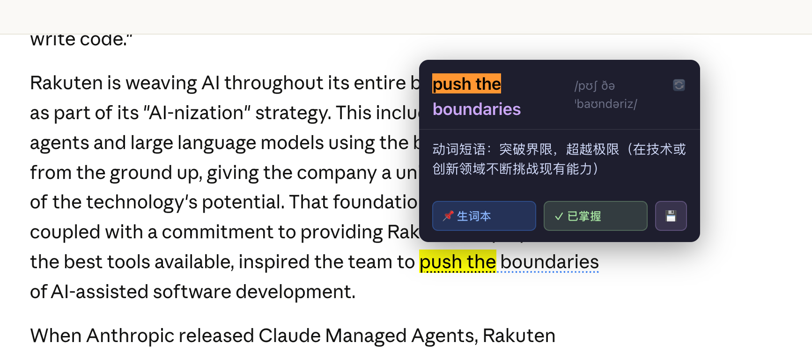
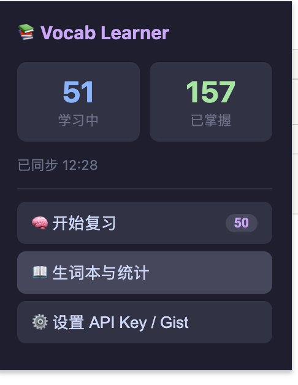
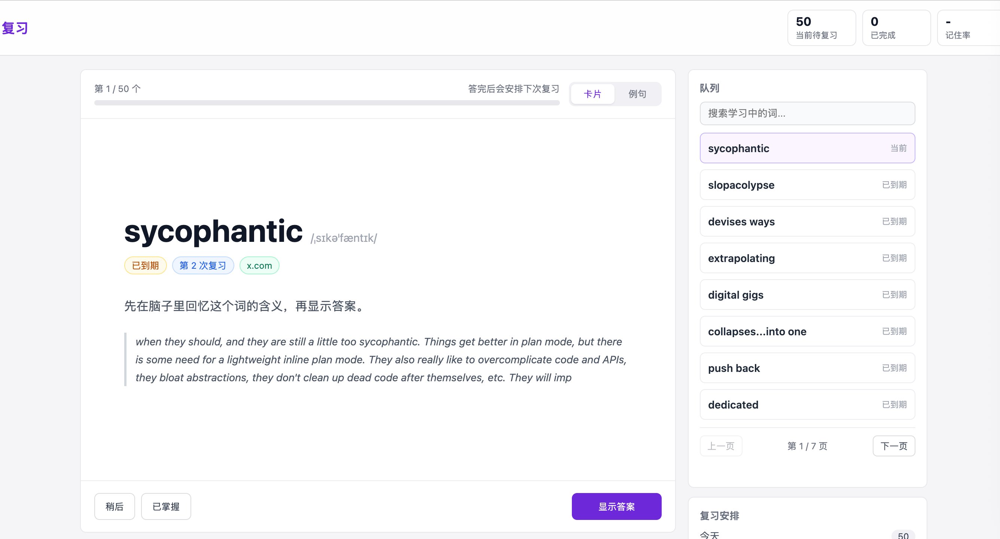
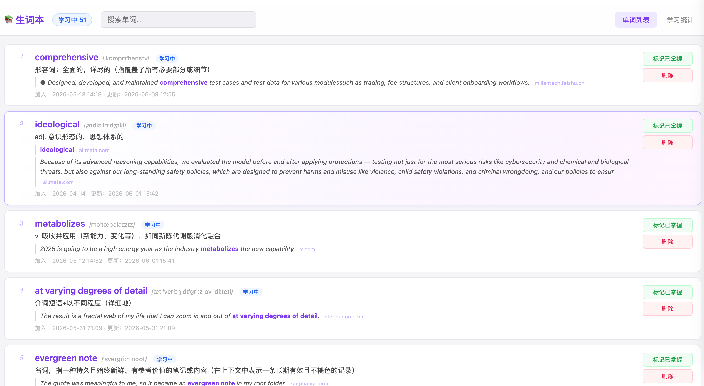
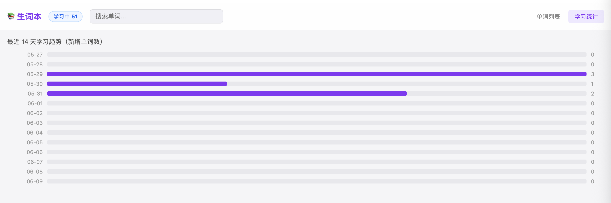
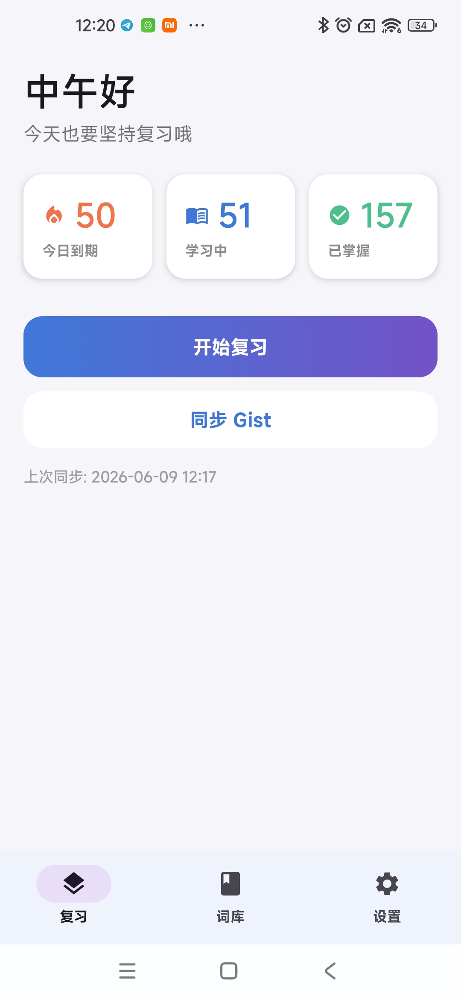
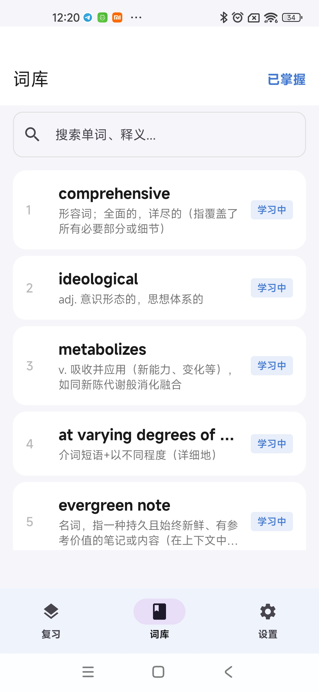
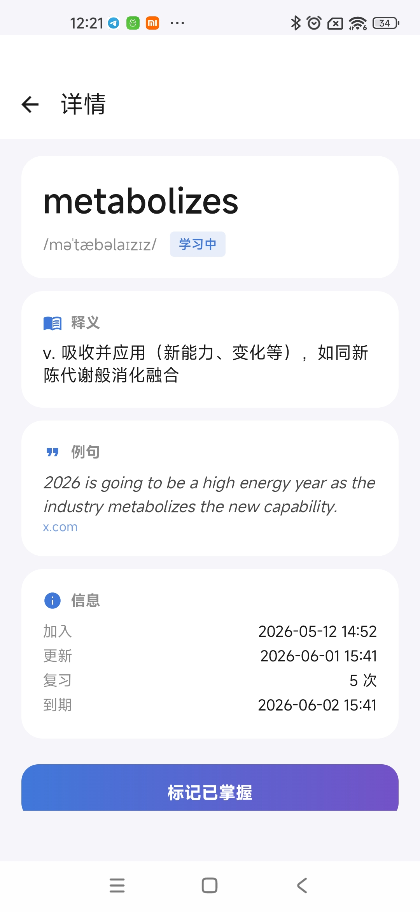
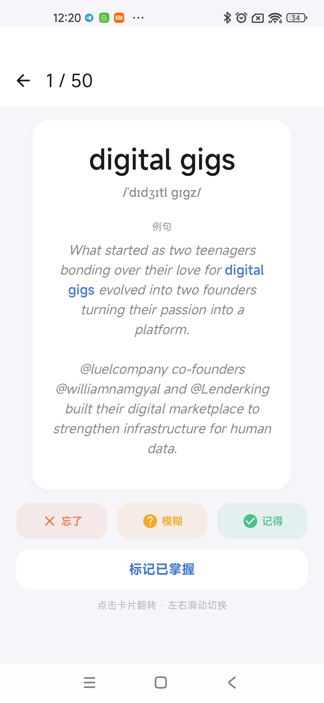
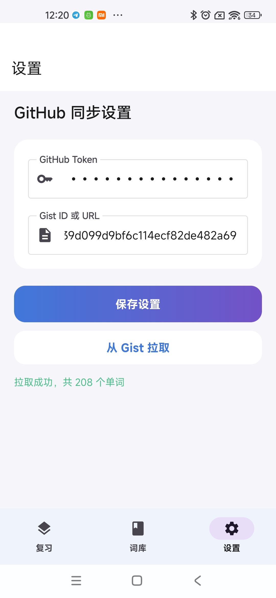

# Vocab Learner

A cross-platform English vocabulary learning project. The browser extension captures words, looks up definitions, and translates text on web pages. The mobile apps (iOS / Android) are designed for review. All data is synced across devices through GitHub Gist.

## Repository Structure

| Directory | Platform | Responsibilities |
|---|---|---|
| [`extension/`](extension/) | Chrome Extension (Manifest V3) | Capture, look up, translate, save, and review words on the web |
| [`android/`](android/) | Android (Jetpack Compose) | Vocabulary review |
| [`ios/`](ios/) | iOS (Swift / UIKit) | Vocabulary review |

All platforms share the same GitHub Gist data. See [`vocab-data-format.md`](vocab-data-format.md) for the data format and synchronization rules.

---

## Download

Android review app (signed APK, requires Android 8.0 or later):

- **Latest version**: [vocab-learner-v0.1.0.apk](https://github.com/hapiman/vocab-plugin/releases/latest/download/vocab-learner-v0.1.0.apk)
- See all versions on the [Releases page](https://github.com/hapiman/vocab-plugin/releases)

> For the browser extension, see [Installation and Build](#installation-and-build) below and load the `extension/` directory.

---

## Features

- **Highlight vocabulary** — Underline words you are learning on every web page you visit.
- **Click to look up** — Click an underlined word to see its definition and example sentences.
- **Translate selected text** — Select English text for AI translation and a breakdown of key phrases.
- **One-click saving** — Save words or phrases to your vocabulary from any popup.
- **Spaced review** — Review due words using the Forgot / Hard / Got It ratings.
- **Vocabulary page** — View saved words, definitions, example sentences, and source URLs.
- **GitHub Gist sync** — Automatically sync your vocabulary to a secret GitHub Gist shared across devices.

---

## Interface Previews

### Browser Extension

**Translate and save selected text on a web page**



**Extension popup**



**Review page**



**Vocabulary — Word list**



**Vocabulary — Learning statistics**



### Android Review App

| Home | Vocabulary | Word Details | Flashcard Review | Sync Settings |
|:---:|:---:|:---:|:---:|:---:|
|  |  |  |  |  |

---

## Installation and Build

### Browser Extension

1. Download or clone this repository.
2. Open Chrome and visit `chrome://extensions/`.
3. Enable **Developer mode** in the upper-right corner.
4. Click **Load unpacked** and select the `extension` folder.
5. The extension icon will appear in the toolbar.

### Android

1. Open the `android/` directory in Android Studio (or use the command line).
2. Build the debug APK:
   ```bash
   cd android && ./gradlew assembleDebug
   ```
3. Install it on a device using adb:
   ```bash
   adb install app/build/outputs/apk/debug/app-debug.apk
   ```
> Building a signed release APK requires signing information in `android/keystore.properties` (this file is not committed to Git).

### iOS

The iOS app uses CocoaPods to manage dependencies:

1. Install dependencies:
   ```bash
   cd ios && pod install
   ```
2. Open **`ios/VocabReview.xcworkspace`** in Xcode (the `.xcworkspace`, not the `.xcodeproj`).
3. Select the target device and run the app.

---

## Configuration

Click the extension icon, then **⚙️ Configure API Key / Gist** to open Settings.

### DeepSeek API Key

The extension uses [DeepSeek](https://platform.deepseek.com/) for AI definitions and translations.

1. Visit [https://platform.deepseek.com/api_keys](https://platform.deepseek.com/api_keys).
2. Create a new API key.
3. Paste it into the **DeepSeek API Key** field in Settings.
4. Click **Save Settings**.

### GitHub Gist Sync (Optional)

Sync your vocabulary to a secret GitHub Gist for backup and sharing across devices.

#### Step 1 — Create a GitHub Personal Access Token

1. Visit [https://github.com/settings/tokens](https://github.com/settings/tokens).
2. Click **Generate new token (classic)**.
3. Give it a name, such as `vocab-learner`.
4. Under **Scopes**, select only **`gist`**.
5. Click **Generate token** and copy it (it will only be shown once).

#### Step 2 — Save the Token in the Extension

1. Open the extension's Settings page.
2. Paste the token into the **GitHub Token** field.
3. Click **Save Settings**.

The extension will automatically create a secret Gist containing `vocab-learner.json` the next time you save a word and sync changes after a 5-second delay.

#### Step 3 — Sync Across Devices (Optional)

To use the same vocabulary on another device:

1. Find your Gist ID: visit [https://gist.github.com](https://gist.github.com), open the Gist containing `vocab-learner.json`, and copy the ID from the URL (the long string after your username).
2. Enter both the GitHub token and **Gist ID** in the extension settings on the second device.
3. Click **Pull from Gist Now** to import your existing vocabulary.

---

## Usage

| Action | How |
|---|---|
| View a saved word | Click an underlined word on a web page |
| Look up any word | Select the word, then click the **Aa** icon |
| Translate a sentence | Select the text, then click the **Tr** icon |
| Save a word | Click **📌 Vocabulary** in any popup |
| Mark as mastered | Click **✓ Mastered** in any popup |
| Review due words | Click the extension icon, then **🧠 Start Review** |
| View vocabulary | Click the extension icon, then **📖 Vocabulary & Statistics** |

---

## Spaced Repetition Algorithm

The review system uses an interval-based spaced repetition algorithm. Choose one of three ratings when reviewing a word:

| Rating | Meaning | Next Review | Effect |
|------|------|----------|------|
| **Forgot** | Cannot remember at all | In 10 minutes | Reset the interval to 0; increment miss count |
| **Hard** | Recalled with effort | Tomorrow | Set the interval to 1 day |
| **Got It** | Recalled easily | Progressive interval | Increase the interval; increment correct count |

### Progressive Intervals for Remembered Words

Each consecutive Got It rating increases the interval according to this sequence:

`1 → 3 → 7 → 14 → 30 → 60 → 120 days`

### Other Actions

| Action | Effect |
|------|------|
| **Later** | Postpone for 4 hours without changing statistics |
| **Mastered** | Permanently remove the word from the review queue |

---

## Technology Stack

- **Browser extension**: Chrome Extension Manifest V3, vanilla JavaScript (no framework)
- **Android**: Kotlin, Jetpack Compose
- **iOS**: Swift, UIKit, CocoaPods
- **AI**: [DeepSeek API](https://platform.deepseek.com/)
- **Cloud sync**: GitHub Gist API

---

## Questions and Feedback


## License

MIT
